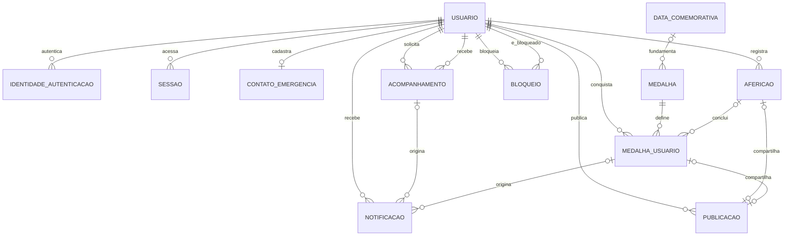
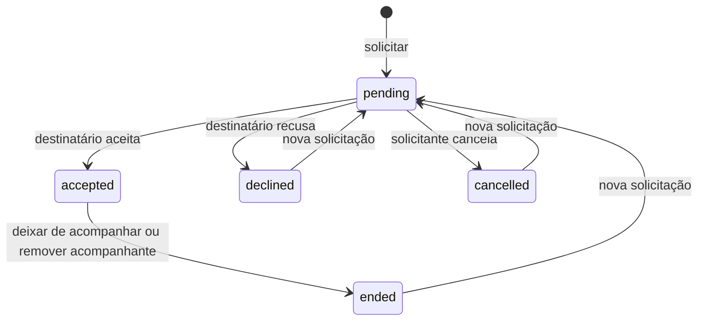

# Modelagem de domínio do GlicNote

Proposta de referência para substituir o estado em memória por persistência e serviços. Inclui os recursos existentes e os recursos planejados. Não pressupõe a escolha de um provedor de autenticação, banco ou backend.

## 1. Escopo e decisões de produto

- Login com Google, com possibilidade de outros provedores no futuro.
- Perfil com nome, nome de usuário único e foto; e-mail e contato de emergência privados.
- Aferições pessoais com glicemia, insulina opcional, momento, data e hora.
- Acompanhamento direcional, mediante solicitação e aprovação.
- Feed cronológico de publicações compartilhadas com acompanhantes aprovados.
- Medalhas por quantidade de aferições, dias consecutivos e datas comemorativas.
- Português, inglês e espanhol na interface; códigos e identificadores independentes do idioma.
- Data, hora e número são formatados na interface. Unidade de glicemia permanece mg/dL; insulina é armazenada em unidades internacionais.

Decisões propostas para a primeira versão: compartilhar é opcional por publicação; aceitar um acompanhante permite acessar as publicações compartilhadas anteriores e futuras enquanto o vínculo estiver ativo. Não permite consultar diretamente o histórico privado. Medalhas são privadas até serem compartilhadas. Esses comportamentos podem ser alterados antes da implementação.

## 2. Relacionamentos

## 3. Convenções

- IDs são UUIDs, permitindo gerar identificadores antes da sincronização.
- Instantes (`*_em`) são armazenados em UTC; datas civis usam um tipo de data, sem hora.
- `criado_em` e `atualizado_em` são atribuídos pelo servidor nos dados remotos.
- Campos opcionais aceitam `null`; não usar strings vazias como ausência no armazenamento.
- Números decimais usam representação decimal exata. Não usar ponto flutuante binário para persistir insulina.
- O cliente nunca escolhe o dono de um registro: o serviço o obtém da sessão autenticada.
- Campos de texto pessoal, como nome e vínculo, são preservados no idioma em que foram escritos.
- Registros compartilhados usam as mesmas fontes de dados das telas privadas; não copiar valores clínicos para o feed.

## 4. Entidades

### 4.1 `usuario`

| Campo | Tipo | Regra |
|---|---|---|
| `id` | UUID | Chave primária |
| `nome` | Texto | Obrigatório após concluir perfil |
| `nome_usuario` | Texto | Único, normalizado e sem distinção de maiúsculas |
| `foto_url` | Texto opcional | Foto de perfil |
| `email` | Texto opcional | Privado; não é identificador de autenticação |
| `aniversario_mes` | Inteiro opcional | 1–12, usado apenas se habilitada medalha de aniversário |
| `aniversario_dia` | Inteiro opcional | Par válido com o mês; não exige ano de nascimento |
| `fuso_horario` | Texto | Identificador IANA, por exemplo `America/Sao_Paulo` |
| `criado_em` | Instante | Criação |
| `atualizado_em` | Instante | Última alteração |

O perfil visível a outros usuários contém apenas ID, nome, nome de usuário e foto. A busca de pessoas usa nome de usuário ou link de perfil. E-mail, aniversário e contato de emergência não entram nas respostas de busca.

Idioma acompanha o dispositivo; não é necessário persistir uma preferência neste momento. O fuso do perfil representa o contexto atual e não altera datas históricas já registradas.

### 4.2 `identidade_autenticacao`

| Campo | Tipo | Regra |
|---|---|---|
| `id` | UUID | Chave primária |
| `usuario_id` | UUID | FK para usuário |
| `provedor` | Enum | Inicialmente `google` |
| `identificador_provedor` | Texto | Identificador estável do provedor |
| `criado_em` | Instante | Primeiro vínculo |
| `ultimo_login_em` | Instante | Último acesso |

Restrição única em `(provedor, identificador_provedor)`. Para Google, usar o `sub` do token validado; não associar contas automaticamente pelo endereço de e-mail. Nome e foto recebidos no primeiro login podem preencher o perfil; acessos posteriores não sobrescrevem edições feitas pelo usuário.

A validação de identidade e a emissão de sessão pertencem ao serviço de autenticação, nunca somente ao cliente. Referência: [validação de ID tokens Google](https://developers.google.com/identity/gsi/web/guides/verify-google-id-token).

### 4.3 `sessao`

Entidade lógica; pode ser integralmente gerenciada pelo serviço de autenticação escolhido.

| Campo | Tipo | Regra |
|---|---|---|
| `id` | UUID | Chave primária |
| `usuario_id` | UUID | FK para usuário |
| `criada_em` | Instante | Início |
| `expira_em` | Instante | Expiração |
| `revogada_em` | Instante opcional | Logout ou revogação |

Não persistir tokens brutos na tabela de perfil. Se o backend gerenciar refresh tokens, armazenar apenas seus hashes e aplicar rotação. O cache local fica separado por usuário e é removido ou isolado no logout.

### 4.4 `afericao`

| Campo | Tipo | Regra |
|---|---|---|
| `id` | UUID | Chave primária; reaproveitada nas tentativas de sincronização |
| `usuario_id` | UUID | FK para usuário |
| `glicemia_mg_dl` | Inteiro | Maior que zero |
| `insulina_ui` | Decimal opcional | Maior ou igual a zero |
| `momento` | Enum | Código estável |
| `aferido_em` | Instante | Quando a aferição aconteceu |
| `fuso_horario` | Texto | Fuso IANA na aferição |
| `data_local` | Data | Derivada de `aferido_em` e do fuso; usada em histórico e medalhas |
| `criado_em` | Instante | Quando o servidor recebeu o registro |
| `atualizado_em` | Instante | Última edição |
| `versao` | Inteiro | Controle de atualização concorrente |

Momentos: `fasting`, `after_breakfast`, `after_lunch`, `after_snack`, `after_dinner`, `other`. São traduzidos somente na interface. Os identificadores atuais em português deverão ser migrados para esses códigos.

`insulina_ui = null` significa não informado; `0` significa nenhuma insulina utilizada. A aferição não pode ser datada no futuro; o servidor valida o instante e deriva `data_local`, sem confiar em uma data enviada isoladamente. Precisão decimal e tolerância de relógio devem ser fixadas na implementação.

O filtro por período usa `data_local`, incluindo os dois extremos. A data local histórica é preservada ao viajar ou alterar o fuso do perfil. Mudanças explícitas na data/fuso de uma aferição recalculam sua data local e o progresso de medalhas.

### 4.5 `contato_emergencia`

| Campo | Tipo | Regra |
|---|---|---|
| `id` | UUID | Chave primária |
| `usuario_id` | UUID único | Um contato por usuário nesta versão |
| `nome` | Texto | Obrigatório |
| `telefone` | Texto | Preferencialmente normalizado com código do país |
| `vinculo` | Texto opcional | Texto livre |
| `criado_em` | Instante | Criação |
| `atualizado_em` | Instante | Última edição |

Privado, acessível apenas ao dono. Não cria usuário, convite ou acompanhamento automaticamente. Caso sejam necessários vários contatos no futuro, remover a unicidade de `usuario_id` e adicionar prioridade.

### 4.6 `acompanhamento`

| Campo | Tipo | Regra |
|---|---|---|
| `id` | UUID | Chave primária |
| `solicitante_id` | UUID | Quem deseja acompanhar |
| `acompanhado_id` | UUID | Quem aprova o acesso |
| `status` | Enum | `pending`, `accepted`, `declined`, `cancelled`, `ended` |
| `solicitado_em` | Instante | Solicitação mais recente |
| `respondido_em` | Instante opcional | Aceite ou recusa |
| `encerrado_em` | Instante opcional | Cancelamento ou encerramento |
| `versao` | Inteiro | Evita decisões concorrentes sobre uma solicitação antiga |

Restrições: par `(solicitante_id, acompanhado_id)` único; usuário não acompanha a si mesmo. O vínculo é direcional: A acompanhar B não concede a B acesso a A.

Nova solicitação reutiliza o relacionamento, incrementa a versão e limpa os timestamps da decisão anterior. Notificações incluem a versão da solicitação, para não tratar uma decisão antiga como atual. Repetir a mesma operação não cria outro vínculo. Se for necessário histórico completo de decisões, adicionar uma tabela de eventos; ela não é necessária para consultar o vínculo atual.

### 4.7 `bloqueio`

| Campo | Tipo | Regra |
|---|---|---|
| `bloqueador_id` | UUID | Usuário que bloqueou |
| `bloqueado_id` | UUID | Usuário bloqueado |
| `criado_em` | Instante | Criação |

Chave composta pelos dois usuários; proibir autobloqueio. Bloqueio em qualquer direção impede novas solicitações e acesso social entre o par. Ao bloquear, encerrar vínculos aceitos e cancelar pendências nas duas direções. Desbloquear não restaura acompanhamentos anteriores.

### 4.8 `data_comemorativa`

| Campo | Tipo | Regra |
|---|---|---|
| `id` | UUID | Chave primária |
| `codigo` | Texto único | Chave estável de tradução |
| `tipo` | Enum | `fixed_annual`, `specific_date`, `birthday` |
| `mes` / `dia` | Inteiros opcionais | Obrigatórios para data anual fixa |
| `data_especifica` | Data opcional | Obrigatória para evento de uma única edição |
| `regiao` | Texto opcional | Escopo de calendário, como `BR`; não deduzir do idioma |
| `ativa` | Booleano | Participa de novas avaliações |

Para aniversário, consultar mês e dia privados do usuário; nenhum ano de nascimento é necessário. Eventos regionais ficam fora da primeira versão enquanto não houver preferência explícita de região. Datas globais funcionam sem esse campo. Proposta para 29/02: aniversário é elegível apenas em 29/02, sem substituição automática por outro dia.

### 4.9 `medalha`

| Campo | Tipo | Regra |
|---|---|---|
| `id` | UUID | Chave primária |
| `codigo` | Texto único | Ex.: `first_reading`, `readings_10`, `streak_7` |
| `icone_chave` | Texto | Referência a asset |
| `tipo_regra` | Enum | `reading_count`, `day_streak`, `special_date` |
| `meta` | Inteiro opcional | Maior que zero para quantidade ou sequência |
| `data_comemorativa_id` | UUID opcional | Obrigatória para `special_date` |
| `repeticao` | Enum | `once`, `annual` |
| `regra_versao` | Inteiro | Versão semântica da regra |
| `ordem` | Inteiro | Ordem de apresentação |
| `ativa` | Booleano | Disponível para novas conquistas |

Validação por tipo: contagem e sequência exigem meta, não aceitam data comemorativa e são únicas na primeira versão; data especial exige referência a evento e permite repetição anual quando compatível. Nome e descrição usam o código nos catálogos de tradução. Alterações que mudem o significado de uma conquista criam outra medalha/código; não reinterpretar conquistas antigas silenciosamente.

Catálogo inicial proposto:

| Código | Regra |
|---|---|
| `first_reading` | 1 aferição |
| `readings_10`, `readings_50`, `readings_100` | 10, 50 e 100 aferições |
| `streak_3`, `streak_7`, `streak_14`, `streak_30` | Dias consecutivos distintos |
| `birthday_reading` | Aferição no aniversário, se informado; anual |
| `special_date_<codigo>` | Aferição em evento cadastrado |

As medalhas reconhecem registro e constância. Não dependem do valor da glicemia, da quantidade de insulina ou da frequência de medições dentro de um dia.

### 4.10 `medalha_usuario`

| Campo | Tipo | Regra |
|---|---|---|
| `id` | UUID | Chave primária |
| `usuario_id` | UUID | Dono da conquista |
| `medalha_id` | UUID | Definição da medalha |
| `edicao` | Texto | `lifetime` ou ano do evento, como `2026` |
| `regra_versao` | Inteiro | Regra usada na concessão |
| `afericao_origem_id` | UUID opcional | Aferição que concluiu a regra; pode ser nula após exclusão |
| `atingida_em` | Instante | Quando os registros indicam que a meta foi atingida |
| `conquistada_em` | Instante | Quando o serviço reconheceu a conquista |

Para medalhas anuais, a edição usa o ano da data local da aferição elegível, não o ano de processamento.

Único em `(usuario_id, medalha_id, edicao)`. Reprocessamento ou repetição de sincronização não duplica conquistas.

Regras de progresso:

- Quantidade conta aferições existentes do usuário.
- Sequência usa as datas locais distintas, consecutivas, sem multiplicar dias com várias aferições.
- Sequência atual: conta para trás a partir de hoje, ou de ontem se hoje ainda não houver registro. Se o último registro for anterior a ontem, é zero. Hoje é calculado no fuso atual do perfil.
- Maior sequência: maior intervalo consecutivo entre as datas locais históricas.
- Data comemorativa compara a data local da aferição com o evento.
- Lançamentos retroativos e edições podem preencher lacunas; recalcular o progresso e reconhecer conquistas correspondentes.
- Alterar aniversário não concede medalha diretamente: uma reavaliação encontra aferições elegíveis, se existirem.
- Proposta de produto: conquistas concedidas permanecem como marco histórico após editar/excluir aferições; progresso atual é recalculado. Excluir conta remove as conquistas.

Não é necessária tabela de progresso inicialmente. Calcular consultas/agregações e adicionar cache reconstruível apenas quando houver demanda de desempenho. Apresentar separadamente “medalha já conquistada” e “progresso atual”.

### 4.11 `publicacao`

| Campo | Tipo | Regra |
|---|---|---|
| `id` | UUID | Chave primária |
| `autor_id` | UUID | Dono do conteúdo |
| `tipo` | Enum | `reading`, `badge` |
| `afericao_id` | UUID opcional e único | Referência para publicação de aferição |
| `medalha_usuario_id` | UUID opcional e único | Referência para publicação de conquista |
| `texto` | Texto opcional | Legenda escrita pelo autor |
| `criado_em` | Instante | Publicação, usada na ordenação |
| `atualizado_em` | Instante | Edição da legenda |

Exatamente uma referência deve ser preenchida, compatível com `tipo`, e pertencer a `autor_id`. Uma aferição ou conquista tem no máximo uma publicação nesta versão. A autoria deve ser garantida pelo serviço e por integridade referencial/constraints adequadas ao banco escolhido.

Não armazenar cópias de glicemia, insulina, nome de medalha ou data da aferição na publicação. Edição da aferição atualiza a apresentação da publicação; alteração não muda sua posição no feed. Exclusão da aferição exclui sua publicação. Remover publicação mantém o registro privado. O conteúdo compartilhado de aferição contém glicemia, insulina quando informada, momento e horário; não inclui perfil privado ou contato de emergência.

O feed é uma consulta, não outra entidade: próprias publicações mais publicações dos usuários acompanhados com vínculo aceito, sem bloqueio em nenhuma direção. Ordenação por `(criado_em DESC, id DESC)` e paginação por cursor. Aplicar as mesmas regras ao acesso por ID/link direto, não apenas à lista.

### 4.12 `notificacao`

| Campo | Tipo | Regra |
|---|---|---|
| `id` | UUID | Chave primária |
| `destinatario_id` | UUID | Dono da caixa de notificações |
| `ator_id` | UUID opcional | Quem iniciou a ação |
| `tipo` | Enum | `follow_requested`, `follow_accepted`, `badge_earned` |
| `acompanhamento_id` | UUID opcional | Referência do evento social |
| `solicitacao_versao` | Inteiro opcional | Versão da solicitação, quando aplicável |
| `medalha_usuario_id` | UUID opcional | Referência da conquista |
| `evento_chave` | Texto único | Impede duplicação do mesmo evento/destinatário |
| `criado_em` | Instante | Criação |
| `lida_em` | Instante opcional | Leitura |

Não persistir uma frase já traduzida. A interface monta o texto pelo tipo e pelos dados autorizados. Notificação não concede acesso ao recurso; um vínculo encerrado pode deixar a notificação sem ação disponível. Push pode ser adicionado depois com uma entidade separada de dispositivos/tokens.

## 5. Matriz de acesso

| Recurso | Dono | Acompanhante aceito | Outro usuário |
|---|---|---|---|
| Nome, nome de usuário, foto | Ler/editar | Ler | Ler por busca/link |
| E-mail, aniversário, contato de emergência | Ler/editar | Sem acesso | Sem acesso |
| Aferição privada e histórico completo | Ler/editar/excluir | Sem acesso | Sem acesso |
| Publicação compartilhada | Ler/editar/remover | Ler enquanto houver vínculo | Sem acesso |
| Medalhas privadas e progresso | Ler | Sem acesso | Sem acesso |
| Medalha compartilhada em publicação | Ler/remover publicação | Ler enquanto houver vínculo | Sem acesso |
| Solicitação | Envolvidos podem ler | Sem acesso como terceiro | Sem acesso |
| Notificação | Apenas destinatário lê/marca | Sem acesso | Sem acesso |

Nos relacionamentos, solicitante cancela pendência/deixa de acompanhar; acompanhado aceita, recusa ou remove acompanhante. Nenhum dos lados altera o perfil ou registros do outro. Bloqueio prevalece sobre permissões de leitura social.

## 6. Fluxos e consistência

### Login

1. App obtém credencial Google e a entrega ao serviço de autenticação.
2. Serviço valida a credencial e encontra/cria a identidade e o usuário.
3. Serviço retorna sessão; perfil incompleto segue para nome de usuário e fuso.
4. Dados locais anteriores podem ser importados somente por ação explícita do usuário, para a conta autenticada. Usar UUIDs originais e idempotência para evitar duplicações.

### Registrar uma aferição

1. Autenticar usuário, validar campos e calcular data local.
2. Persistir por ID; repetição idêntica retorna o mesmo registro, sem incrementar contagem.
3. Avaliar medalhas considerando aferições em ordem por data de ocorrência.
4. Inserir conquistas com chave única e gerar uma notificação por nova conquista.
5. Atualizar Home, histórico e progresso.
6. Compartilhar somente se o usuário confirmar; publicação de medalha também é opcional.

Na primeira versão, avaliação pode ocorrer no mesmo serviço/transação. Ao separar em processamento assíncrono, usar uma caixa de eventos transacional (`outbox`) e consumidores idempotentes. A fonte de verdade continua sendo a aferição persistida; progresso pode ser reconstruído.

### Solicitar/aceitar acompanhamento

1. Conferir usuários distintos, existência, bloqueios e vínculo atual.
2. Criar/atualizar solicitação pendente e notificar o destinatário.
3. Aceite autentica o destinatário e verifica status e versão esperados.
4. Ativar vínculo e notificar solicitante.
5. Feed passa a consultar as publicações compartilhadas do acompanhado.
6. Encerramento ou bloqueio retira o acesso imediatamente no servidor e invalida o cache social correspondente no cliente.

### Exclusões

- Excluir aferição remove sua publicação, recalcula progresso e preserva medalhas já concedidas; referência de origem da medalha fica nula.
- Excluir contato de emergência remove apenas esse contato.
- Excluir publicação não exclui aferição ou medalha.
- Encerrar acompanhamento não exclui registros ou publicações do autor; elimina a autorização do acompanhante.
- Excluir conta revoga sessões e remove identidades, aferições, contatos, relações, bloqueios, publicações, conquistas e notificações associadas. Notificações de terceiros referentes à conta também são removidas ou deixam de expor dados do usuário excluído, conforme política de retenção definida na implementação.

## 7. Índices e consultas principais

| Índice/restrição | Uso |
|---|---|
| `usuario(nome_usuario_normalizado)` único | Busca e identidade pública |
| `identidade_autenticacao(provedor, identificador_provedor)` único | Login |
| `afericao(usuario_id, aferido_em DESC, id DESC)` | Última aferição, recentes e paginação |
| `afericao(usuario_id, data_local, momento)` | Filtros combinados e datas distintas |
| `acompanhamento(solicitante_id, acompanhado_id)` único | Vínculo e idempotência |
| `acompanhamento(acompanhado_id, status, solicitado_em DESC)` | Pendências e acompanhantes |
| `acompanhamento(solicitante_id, status, acompanhado_id)` | Quem acompanho e autorização do feed |
| `bloqueio(bloqueador_id, bloqueado_id)` único | Bloqueios nas duas direções |
| `medalha_usuario(usuario_id, medalha_id, edicao)` único | Concessão sem duplicidade |
| `publicacao(autor_id, criado_em DESC, id DESC)` | Feed por autor |
| `notificacao(destinatario_id, criado_em DESC, id DESC)` | Caixa de notificações |
| `notificacao(evento_chave)` único | Notificações sem duplicação |

Home usa aferições do dono: última medição, quatro recentes, média e contagem. Histórico usa aferições do dono e filtros combináveis. Feed usa publicações autorizadas. Médias, contagens, seguidores e sequências não são tabelas independentes nesta fase.

## 8. Organização no Flutter

| Camada | Responsabilidade |
|---|---|
| Modelos de domínio | `UserProfile`, `GlucoseReading`, `EmergencyContact`, `FollowRelationship`, `BadgeDefinition`, `EarnedBadge`, `FeedPost` |
| Repositórios | Interfaces para autenticação, perfil, aferições, acompanhamento, feed e medalhas |
| Casos de uso | Registrar aferição, solicitar/aceitar acompanhamento, compartilhar e carregar progresso |
| Estado/apresentação | Carregamento, erros, paginação, atualização após ações e isolamento por usuário |
| Widgets | Componentes visuais e formulários; recebem dados e callbacks |
| Localização | Traduções por códigos de domínio e formatação local |

Mover `GlucoseEntry` de `screens.dart` para o domínio. Componentes não devem importar telas para obter modelos. O fluxo remoto não pode depender de cálculos exclusivos do cliente para autorização ou concessão de medalhas.

Persistência local pode servir de cache por usuário. Registro offline usa UUID e fila de sincronização; duas alterações concorrentes usam `versao` para rejeitar sobrescrita silenciosa e recarregar/resolver o registro. Até sincronizar, uma aferição pode aparecer como pendente; medalhas remotas são confirmadas pelo serviço. Login exige conectividade.

## 9. Entregas sugeridas

1. Modelos e repositórios; armazenamento local; migração dos dados em memória.
2. Backend/autenticação Google; perfil e persistência remota de aferições/contato.
3. Busca de usuários, solicitações, decisões, encerramento e bloqueio.
4. Publicação opcional de aferições e feed cronológico autorizado.
5. Catálogo de medalhas, avaliação idempotente, progresso e galeria no Perfil.
6. Datas comemorativas e compartilhamento de conquistas.
7. Notificações remotas/push, caso desejado.

Comentários, curtidas, chat, ranking e alertas automáticos ficam fora desta primeira modelagem. A escolha de backend, precisão de insulina, política final de calendário comemorativo e regras de importação de registros anteriores são decisões da implementação, sem impedir a definição das entidades acima.
